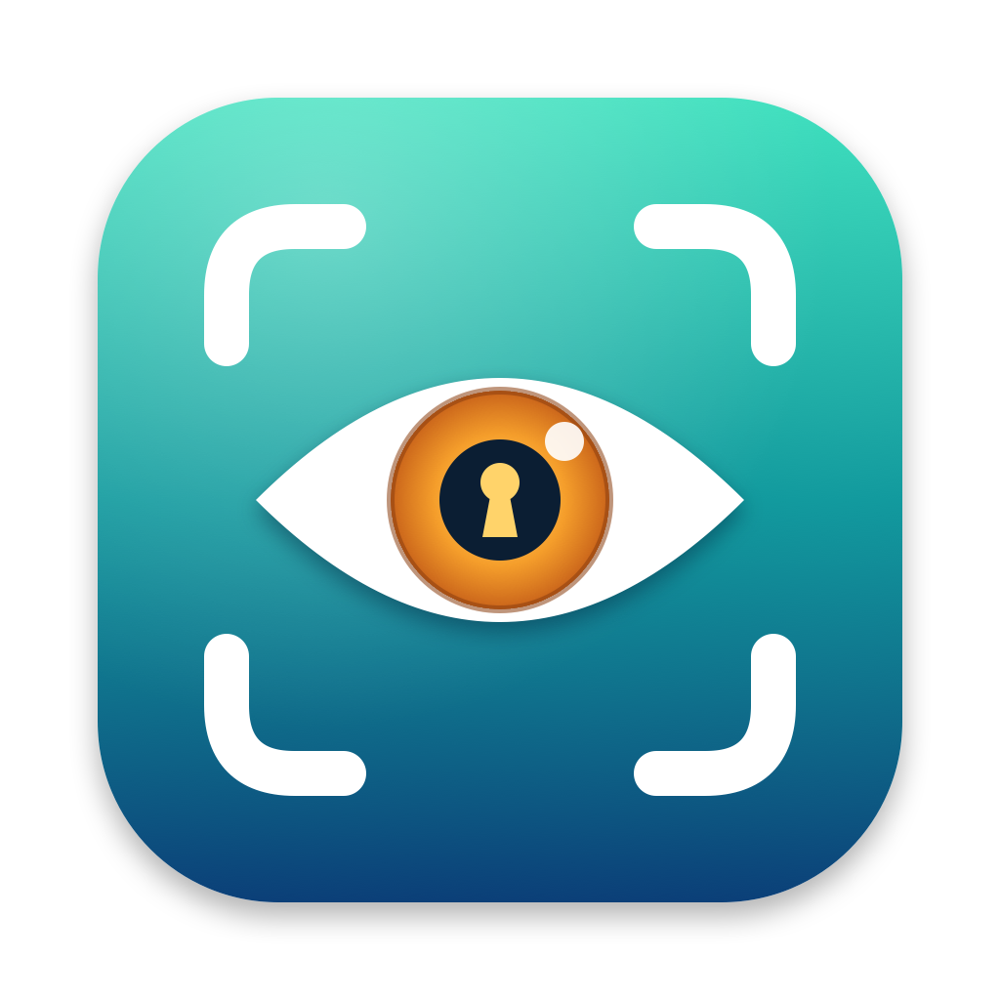

<p align="center"></p>

# Walk Off 👀

**Locks your Mac when you walk away, and wakes the screen when you come back.**

Walk Off is a small menu-bar app for macOS. It uses
your Mac's camera to notice when you've left your desk and locks the screen. When you sit back down,
it wakes the screen so Touch ID or your Apple Watch can unlock it straight away. It's the closest
thing to iPhone's Face ID that macOS allows.

## What it can and can't do

| | |
|---|---|
| ✅ Locks the Mac when your face has gone | after you've stopped typing for a while |
| ✅ Wakes the screen when you're back | so Touch ID / Apple Watch can unlock it |
| ✅ Leaves the camera off while you type | it only looks once you go quiet |
| ❌ Unlock the Mac with your face | **not possible, on purpose** (see below) |

**Why no face unlock?** macOS doesn't let apps unlock the lock screen. The only way in is a login
plugin installed as root, and a mistake there can lock you out of your own Mac. Also, the FaceTime
camera only sees a flat picture. iPhone's Face ID uses a 3D depth sensor, so a printed photo can't
fool it, but a photo *could* fool a webcam. A webcam "face unlock" would be weaker than your
password.

**For a hands-free unlock**, turn on **System Settings › Touch ID & Password › Apple Watch**. When
Walk Off wakes the screen as you sit down, your watch unlocks it.

## How it works

1. **You're typing or using the mouse:** the camera is off.
2. **You go quiet for 15 seconds:** the camera turns on and looks for a face close to the Mac.
3. **It sees you:** the camera turns off again and checks back every 10 seconds while you stay quiet.
   You can read, watch or think without the Mac locking.
4. **No face for 10 seconds:** the Mac locks and the display turns off.
5. **While locked (up to 30 minutes):** once the screen has been empty for a few seconds, a face that
   stays for a moment wakes the display. The Mac is still locked: you unlock it as usual.

If the camera fails, is in use elsewhere and stops sending pictures, or the lid is closed, Walk Off
**never locks**. It shows 👀⚠️ and tells you why.

## Install

1. Download **WalkOff.dmg** from the [latest release](https://github.com/Sravankumartangudu/walk-off/releases/latest).
2. Open it and drag **Walk Off** into **Applications**.
3. Open Walk Off. The app isn't notarised, so if macOS blocks the first launch, go to
   **System Settings › Privacy & Security** and click **Open Anyway**.
4. Allow camera access when macOS asks. The **Camera check** window shows a live preview with a green
   box around your face.

Requires macOS 14 Sonoma or later. Universal: Apple Silicon and Intel.

## Using it

Everything is in the 👀 menu (🙈 = off or paused, 👀⚠️ = camera problem):

| Menu item | What it does | Default |
|---|---|---|
| Lock when I walk away | Turns Walk Off on or off | On |
| Pause | 15 minutes, 1 hour, until tomorrow (6 AM) or until you resume | — |
| Start looking after idle | How long you must be quiet before the camera turns on | 15 seconds |
| Lock after you've gone for | How long without a face before it locks | 10 seconds |
| Camera while you're idle | Peek every 10 s or 30 s, or keep it on (faster lock, camera light stays on) | Peek every 10 s |
| Faces that count | Close (about 1.5 m), same room (about 3 m), or anywhere in view. Keeps someone walking past behind you from counting as you | Close |
| Turn the display off after locking | Saves power once it has locked | On |
| Wake the screen when I'm back | Watches for you while locked | On |
| Watch for me after locking | How long it keeps watching after a lock | 30 minutes |
| Camera | Which camera to use. Your iPhone (Continuity Camera) is listed but never picked by default | Built-in |
| Camera check… | Live preview: green box = counts, grey box = too far away | — |
| Lock now | Locks straight away | — |
| Appearance | System, Light or Dark | System |
| Open at login | Starts Walk Off when you log in | Off |

**Tips**
- Watching a film from the sofa? Choose **Faces that count › Same room**, or **Pause** for an hour.
- The green camera light comes on while Walk Off looks. That's macOS showing you the camera is in use.
- Walk Off doesn't recognise *whose* face it is. It only checks that a face is there. It's a
  "lock when I leave" helper, not a security barrier, and your password, Touch ID or watch still
  guards the Mac.

## Build from source

```sh
git clone https://github.com/Sravankumartangudu/walk-off.git
cd walk-off
./build.sh            # runs the tests, then builds build/Walk Off.app
./build.sh --install  # also copies it to ~/Applications and opens it
./build.sh --dist     # also makes build/WalkOff.dmg and build/WalkOff.zip
```

- Tests on their own: `swiftc -o /tmp/walkoff-tests tests/main.swift Sources/Presence.swift && /tmp/walkoff-tests`
- Icon: `swift Icon/make_icon.swift`

Every local build is ad-hoc signed and gets a new signature, so macOS asks for camera access again
after each rebuild.

## Troubleshooting

| Problem | Fix |
|---|---|
| 👀⚠️ "Camera access is off" | System Settings › Privacy & Security › Camera › turn on Walk Off (or 👀 › Turn on camera access…) |
| 👀⚠️ "No camera found" | The lid is closed or no webcam is connected. Walk Off won't lock until a camera is back |
| It locks while I'm sitting there | Open **Camera check**. If your box is grey, choose **Faces that count › Same room**. Dim light can hide a face too |
| It doesn't lock when I leave | Someone else in view? Their face counts. Use **Close**. Also check you're not paused (🙈) |
| The screen doesn't wake when I come back | Turn on **Wake the screen when I'm back**. It only watches for the **Watch for me after locking** time after a lock |
| My iPhone's camera turned on | Pick the built-in camera under 👀 › Camera |

## Privacy

No network, no accounts, no analytics. Pictures are checked in memory, a few times a second, and
dropped straight away. See [SECURITY.md](SECURITY.md).

## License

MIT. See [LICENSE](LICENSE).
